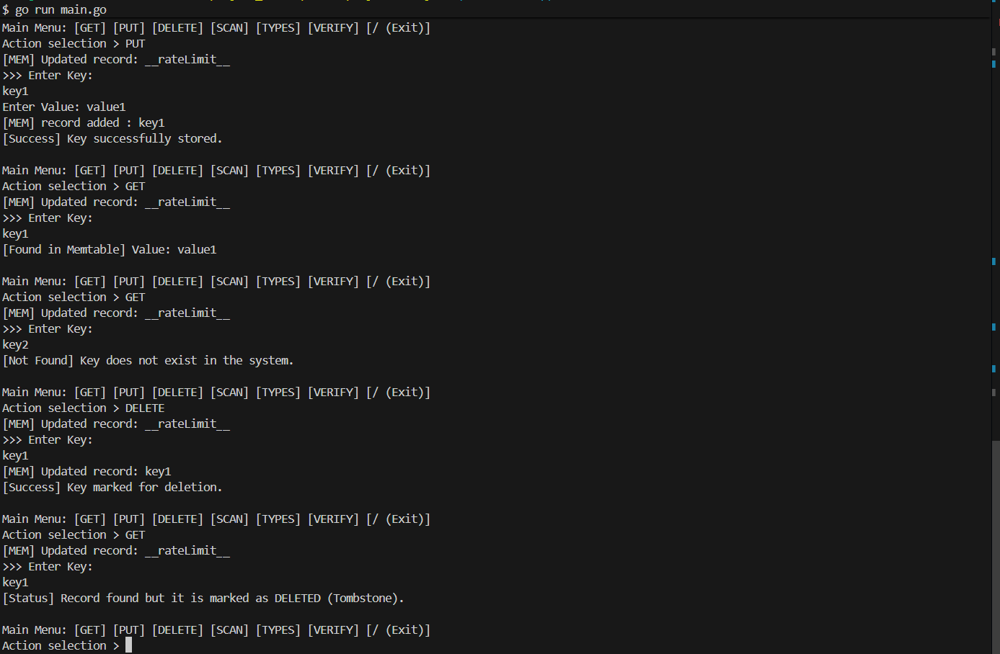

# 🗄️ Go-LSM: High-Performance NoSQL Key-Value Engine

A modular, persistent key-value storage engine built in **Go**, modeled after the **LSM-tree (Log-Structured Merge-tree)** architecture. Designed for high-write throughput and efficient retrieval, this system incorporates multi-layered indexing, advanced caching, and a suite of probabilistic data structures.

---

## 👥 Authors

- [**Nikola Savić**](https://github.com/nikolasa004)
- [**Branislav Marković**](https://github.com/bane-31)
- [**Uroš Milinović**](https://github.com/UrosMilinovic)
- [**Nikola Bjelica**](https://github.com/nikola0234)
- [**Lazar Vilotić**](https://github.com/LazarVilotic)

---

## 📺 Demo

The following represents the core CLI-based interaction with the storage engine:



> **Workflow Summary:**
> - Users perform standard `PUT`, `GET`, and `DELETE` operations.
> - Data is persisted sequentially to disk while maintaining fast in-memory access.
> - Probabilistic structures are managed via a dedicated API layer.

---

## ⚙️ Prerequisites, Installation, and Running

### Prerequisites
- **Go** (version 1.23.2 or higher)
- **Git**

### Installation
1. **Clone the repository:**
   ```bash
   git clone https://github.com/nikolasa004/NASP-projekat.git
   cd NASP-projekat/Project
   ```
2. **Setup dependencies:**
   ```bash
   go mod download
   ```

### Running the App
Start the engine with your current `config.json` settings:
```bash
go run main.go
```

---

## 💡 Description of the Problem and Solution

**The Problem:**
Traditional database engines often struggle with **Write Amplification** and random I/O bottlenecks when handling high-velocity data ingestion. In scenarios like real-time telemetry or massive log processing, traditional B-Trees become a bottleneck as they require frequent disk seeks to maintain a sorted global index.

**The Solution:**
**Go-LSM** utilizes the **LSM-Tree** architecture to transform random writes into high-speed sequential writes. By buffering data in memory (**Memtables**) and periodically flushing them to disk as immutable sorted files (**SSTables**), we ensure peak write performance. To maintain read efficiency, we implement a tiered lookup system involving **Bloom Filters**, **Index Summaries**, and **LRU Caching**, ensuring we rarely hit the disk unnecessarily.

---

## 🛠️ Used Technologies

- **Go (Golang):** Selected for its native concurrency primitives (Goroutines), efficient memory management, and excellent performance for systems-level development.
- **JSON:** Used for a comprehensive **Configuration System**, allowing runtime tuning of memtable sizes, compaction strategies, and cache parameters.
- **Standard Library:** Built primarily on Go's `os`, `io`, and `binary` packages to ensure maximum control over the data path and low-level disk I/O.

---

## 📂 Project Structure

```text
Project/
├── BlockManager/   # WAL, Segmented Log management, and paged Buffer Pool
├── Memtable/       # In-memory structures: B-Tree, SkipList, and HashMap
├── sstable/        # SSTable components: Data, Index, Summary, Bloom, and Merkle
├── lsm_tree/       # Compaction logic: Size-Tiered and Leveled strategies
├── cache/          # LRU Caching mechanism for hot records
├── Types/          # Probabilistic structures: HLL, SimHash, CMS, Bloom
├── Iterator/       # Multi-level data traversal (Memtable & SSTable)
├── Scanners/       # Range and Prefix scanning with specialized cache support
├── RateLimit/      # Token Bucket algorithm for request throttling
└── config/         # Config loaders (readConfig.go) and parameters
```

---

## 🏗️ Additional Details about Implementation

The engine follows a **modular, layered architecture** to ensure reliability and performance:

1. **Write Path:** Every modification is first recorded in the **Write-Ahead Log (WAL)** for durability. It is then inserted into the active **Memtable**. We support multiple Memtables, rotating the active table and flushing filled tables to disk as needed.
2. **Read Path:** A strict lookup hierarchy is followed: **Memtable** → **LRU Cache** → **SSTables** (from Level 0 downwards).
3. **Data Integrity:** Every SSTable is accompanied by a **Merkle Tree**, allowing for efficient verification of data blocks and detection of silent corruption.
4. **Design Patterns:** We utilize the **Strategy Pattern** for Memtable implementations and a **Block Manager** to abstract complex disk I/O through paged memory.

---

## 📋 Table of Contents for Features

| Feature | Status |
| :--- | :--- |
| **Standard CRUD (GET, PUT, DELETE)** | ✅ Completed |
| **Write-Ahead Logging (WAL)** | ✅ Completed |
| **Memtable (SkipList / B-Tree / HashMap)** | ✅ Completed |
| **SSTable Multi-file Generation (TOC based)** | ✅ Completed |
| **LSM Compaction (Size-Tiered & Leveled)** | ✅ Completed |
| **LRU Cache (Record Level)** | ✅ Completed |
| **Block Manager & Buffer Pool (Paged I/O)** | ✅ Completed |
| **Probabilistic Structures (HLL, CMS, Bloom, SimHash)** | ✅ Completed |
| **Range & Prefix Scanners (with Cache)** | ✅ Completed |
| **Merkle Tree Integrity Validation** | ✅ Completed |
| **Token Bucket Rate Limiting** | ✅ Completed |
| **External JSON Configuration** | ✅ Completed |

---

## 🚀 Implemented Features

### **1. Pluggable Memtable Structures**
Unlike many engines that offer a single structure, **Go-LSM** supports **SkipLists**, **B-Trees**, and **HashMaps**.
- **SkipLists** and **B-Trees** allow for ordered iteration, essential for efficient SSTable flushing and range scans.
- **HashMaps** offer $O(1)$ lookup performance for specific workloads.

### **2. Sophisticated LSM Compaction**
The engine manages the accumulation of disk files by running compaction when configured thresholds are reached:
- **Size-Tiered:** Compacts groups of SSTables when the number of files on a level reaches the configured limit.
- **Leveled:** Maintains a strict hierarchy of levels to bound the number of files checked during reads, optimizing for retrieval speed.

### **3. Probabilistic Analytics Suite**
Integrated structures for sub-linear memory analysis:
- **Bloom Filters:** Prevents expensive disk reads by filtering out non-existent keys.
- **HyperLogLog:** Estimates unique counts (cardinality) for massive datasets.
- **Count-Min Sketch:** Provides frequency estimation for high-velocity data streams.
- **SimHash:** Detects data similarity using Hamming distance calculations.

### **4. Advanced Read Path: Scanners & Iterators**
The engine provides high-level **Scanners** for **Range Queries** and **Prefix Searches**. These utilize a dedicated **Scanner Cache** to avoid redundant work when performing paginated or repetitive scans across the LSM levels.

### **5. Block Manager & Paged I/O**
The **Block Manager** handles the low-level serialization of data into fixed-size pages. It uses a **Buffer Pool** to ensure that data is read and written in a disk-friendly manner, significantly improving the performance of the underlying SSTable and WAL access.

### **6. Fault Tolerance & Recovery**
Our **Write-Ahead Log (WAL)** implementation uses **Segmented Logging**. After a restart, the engine can replay valid WAL records to reconstruct the in-memory state, supporting durability and recovery.

---

## 🔍 Storage Engine Internals

### **1. Binary WAL Records and Recovery**
Before a `PUT` or `DELETE` modifies the Memtable, the operation is serialized and written to the WAL. Records contain metadata such as a timestamp, key and value lengths, and a **tombstone** flag for deletions. They also include a **CRC32 checksum** that is checked when records are read; records that fail this check are skipped. The WAL uses fixed-size blocks inside segments, with **record fragmentation** for entries that cannot fit into a single block. On startup, the engine uses the available WAL segments to reconstruct recent records. As Memtables are flushed, older log segments can be removed when they are no longer needed for recovery.

### **2. SSTable Organization and Lookups**
When a Memtable is flushed, its records are written into sorted, disk-based **SSTables**. The engine supports both **single-file** and **multi-file** layouts, with a **Table of Contents (TOC)** identifying their components. A lookup first checks the **Bloom Filter** to avoid searching tables that cannot contain the key. For a possible match, the **Summary** narrows down the relevant part of the **Index**, which points to the record in the **Data** section. Each SSTable also includes a **Merkle Tree** for data integrity checks. The engine can optionally use dictionary-based key compression.

### **3. LSM Levels and Compaction**
SSTables are organized into levels, and their accumulation is managed through either **Size-Tiered** or **Leveled** compaction, depending on the JSON configuration. The implementation checks the number of SSTables on a level and triggers merging when the configured threshold is reached. Compaction combines records into new SSTables on subsequent levels, reducing the number of separate files that need to be considered during reads.

### **4. Caching and Block-Level I/O**
The **LRU Cache** keeps recently accessed key-value records available in memory, reducing repeated SSTable lookups. Separately, the **Block Manager** operates on fixed-size disk blocks and uses a **Buffer Pool** to reuse blocks that have already been read. These are two different layers of caching: one stores logical records, while the other helps with lower-level disk access.

### **5. Scanners, Iterators, and Pagination**
The CLI supports both **Prefix Scans** and **Range Scans**, including their iterative variants. Scanning uses iterators over **Memtables** and **SSTables** to traverse matching records from different storage layers. Results can be presented in pages, while a dedicated **Scanner Cache** keeps recently visited pages for faster navigation. This makes it possible to explore a selected portion of the key space without printing every stored record at once.

---
